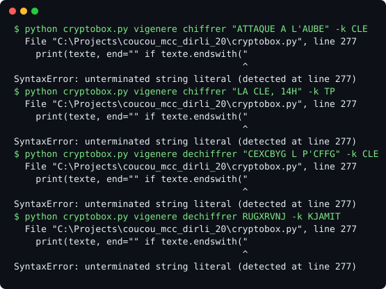
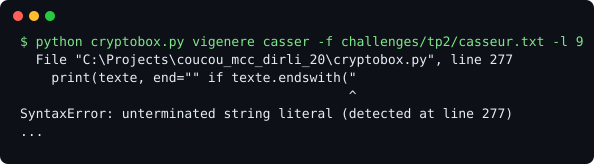
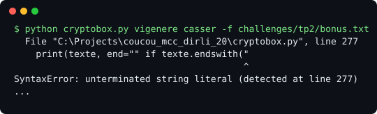
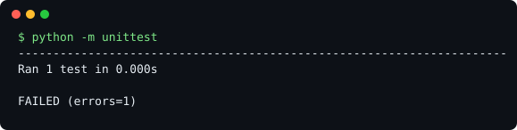

# CryptoBox

Classical cipher toolbox written in pure Python 3. It uses no cryptography library: every
algorithm is coded by hand in `cryptobox.py`.

| Session | Feature |
|---------|---------|
| TP 1 | César (encrypt, decrypt, brute force), substitution, columnar transposition |
| TP 2 | Vigenère (encrypt, decrypt) and an automatic Vigenère breaker |

## Requirements and installation

- Python 3.8 or newer. Nothing to install (standard library only).

```bash
git clone https://github.com/rmz-24/coucou_mcc_dirli_20.git
cd coucou_mcc_dirli_20
python cryptobox.py --help
```

On Windows, if accented characters look wrong in the console, run `set PYTHONIOENCODING=utf-8`
(cmd) or `$env:PYTHONIOENCODING="utf-8"` (PowerShell) first.

## Usage

The tool is a command-line program: `python cryptobox.py <algorithm> <mode> <text> -k <key>`.

### César, substitution, transposition (TP 1)

```bash
python cryptobox.py cesar chiffrer BONJOUR -k 3          # ERQMRXU
python cryptobox.py cesar dechiffrer ERQMRXU -k 3        # BONJOUR
python cryptobox.py cesar brute ERQMRXU                  # prints the 25 candidates

python cryptobox.py substitution chiffrer ATTAQUE -k QWERTYUIOPASDFGHJKLZXCVBNM    # QZZQJXT
python cryptobox.py substitution dechiffrer QZZQJXT -k QWERTYUIOPASDFGHJKLZXCVBNM  # ATTAQUE

python cryptobox.py transposition chiffrer RENDEZVOUSAMIDI -k PORTE     # ESIEVMRZANOIDUD
python cryptobox.py transposition dechiffrer ESIEVMRZANOIDUD -k PORTE   # RENDEZVOUSAMIDI
```

### Vigenère (TP 2)

```bash
python cryptobox.py vigenere chiffrer "ATTAQUE A L'AUBE" -k CLE      # CEXCBYG L P'CFFG
python cryptobox.py vigenere dechiffrer "EP VAX, 14W" -k TP          # LA CLE, 14H
python cryptobox.py vigenere chiffrer "Clé à l'école" -k CLE         # accents and case are handled
```

Long texts can be read from a file with `-f`, or from standard input:

```bash
python cryptobox.py vigenere dechiffrer -f message.txt -k SECRET
type message.txt | python cryptobox.py vigenere dechiffrer -k SECRET     # Windows
cat message.txt | python cryptobox.py vigenere dechiffrer -k SECRET      # Linux / macOS
```

### Vigenère breaker (TP 2)

```bash
# Key length known (-l): prints the key and the decrypted text
python cryptobox.py vigenere casser -f challenges/tp2/casseur.txt -l 9

# Key length unknown: tries L = 2 to 10, shows a table, keeps the smallest readable one
python cryptobox.py vigenere casser -f challenges/tp2/bonus.txt

# Print only the key
python cryptobox.py vigenere casser -f challenges/tp2/bonus.txt -q
```

## How the algorithms work

All functions are in `cryptobox.py`. Letters are mapped to numbers with `A = 0, B = 1, ..., Z = 25`.

### Text preparation

- `normaliser(texte)`: uppercase, accents removed, and every non-letter removed. TP 1 uses it
  (`Rendez-vous à midi` becomes `RENDEZVOUSAMIDI`).
- `preparer(texte)`: uppercase and accents removed, but spaces, digits and punctuation are kept.
  Vigenère uses it (`Clé à l'école` becomes `CLE A L'ECOLE`). Accents are removed by Unicode
  decomposition (NFD): `é` becomes `e` + a combining accent, and the accent is dropped.

### César

`C = (M + k) mod 26`. Decryption is encryption with `-k`. The brute force decrypts with each
key `k = 1 ... 25` and lists the results; the reader picks the readable one.

### Substitution

The key is a 26-letter alphabet. The letter at index `i` of the alphabet is replaced by the
letter at index `i` of the key (A by the 1st letter, B by the 2nd...). Decryption looks up the
position of the letter in the key. The key is checked: exactly 26 letters, each one once.

### Columnar transposition

1. The message is written in rows under the keyword. The last row is padded with `X`.
2. Columns are numbered by the alphabetical order of the keyword letters (with repeated
   letters, the leftmost column comes first).
3. Each column is read top to bottom, in that order.

Decryption computes the number of rows, cuts the ciphertext back into columns, puts each column
back at its original place, and reads row by row.

### Vigenère

Each letter is shifted by the matching key letter: `C = (M + K) mod 26` to encrypt,
`M = (C - K) mod 26` to decrypt. The code follows the TP conventions:

- the text is first passed through `preparer` (uppercase, no accents);
- spaces, digits and punctuation are copied unchanged;
- the key position only advances on letters. A counter `i` is incremented only when the current
  character is a letter, and the key letter used is `cle[i % len(cle)]`.

Encryption and decryption share one function `_vigenere(texte, cle, sens)`, with `sens = +1` or `-1`.

### Vigenère breaker, key length known (`vigenere_casser`)

In French, `E` is by far the most frequent letter (about 17 %). With a key of length `L`, all
letters at positions `j, j+L, j+2L...` are shifted by the same key letter, so each column is a
simple César cipher.

1. Keep only the letters of the ciphertext (`normaliser`).
2. Cut them into `L` columns: column `j` is `lettres[j::L]`.
3. In each column, find the most frequent letter: it is an encrypted `E`.
4. Shift = that letter − `E` (mod 26, so a negative value gets +26). The key letter is the letter
   of rank shift.
5. Join the `L` key letters: this is the key. The text is then decrypted with the Vigenère module.

The method needs a long enough text (several hundred words), so each column has enough letters
for `E` to stand out.

### Vigenère breaker, key length unknown (bonus)

The breaker tries every length `L = 2 ... 10`. For each one it finds a key with the method above,
decrypts the text, and measures how French the result looks:

- **French score** (`score_francais`): chi-squared distance between the letter frequencies of
  the decrypted text and the reference French frequencies, divided by the number of letters.
  Real French scores close to 0 (about 0.01 to 0.03). A wrong key scores several units.
- The chosen length is the **smallest `L` whose score is below 0.2** (`SEUIL_LISIBLE`). Multiples
  of the right length (2L, 3L...) also give readable text, which is why the smallest one is kept.
- The table also shows the average **index of coincidence** (IC) of the columns: about 0.074 for
  French, 0.038 for random letters. It is shown for information only. The IC alone can be fooled:
  with key `SOLEIL` and `L = 3`, the middle column gets the same shift (`L`) twice, so the average
  IC looks French although the text is not readable. The French score of the decrypted text does
  not have this problem.

## Screenshots

Vigenère with the TP examples and the short flag message:



Breaker with a known key length (9):



Breaker with an unknown key length (bonus):



Unit tests:



## Tests

```bash
python -m unittest -v
```

`test_cryptobox.py` covers the examples of both subjects, encrypt/decrypt round trips, `X`
padding, repeated keyword letters, accents, invalid keys, the breaker on a 500-word French text
encrypted with several keys (lengths 3 to 10), length detection, and the three TP 2 challenges.

## Project structure

```
cryptobox.py          all the algorithms and the command-line interface
test_cryptobox.py     unit tests
challenges/tp2/       TP 2 ciphertexts (flag message, breaker text, bonus text)
docs/                 screenshots used in this README
instructions_tp1.md   TP 1 subject
instructions_tp2.md   TP 2 subject
```

## Challenge results (group 48)

### TP 1: three-layer message

Ciphertext `IDADCFGWGDTD`, encrypted with substitution (`OXNKQBTYURPADGCFHIZSWJMVLE`), then
transposition (`POULET`), then César (unknown k). Layers are removed in reverse order, testing
every César key:

```bash
for k in $(seq 1 25); do
  t=$(python cryptobox.py cesar dechiffrer IDADCFGWGDTD -k $k)
  t=$(python cryptobox.py transposition dechiffrer $t -k POULET)
  echo "$k $(python cryptobox.py substitution dechiffrer $t -k OXNKQBTYURPADGCFHIZSWJMVLE)"
done
```

Only `k = 6` gives readable text: `LUCIOLESBBBB` (the `BBBB` is the `X` padding mapped back
through the substitution). Flag: `BSD{LUCIOLES}`.

### TP 2: Vigenère

| Question | Command | Result |
|----------|---------|--------|
| Vigenère flag (key `KJAMIT`) | `python cryptobox.py vigenere dechiffrer RUGXRVNJ -k KJAMIT` | `BSD{HLGLJCDA}` |
| Breaker flag (L = 9) | `python cryptobox.py vigenere casser -f challenges/tp2/casseur.txt -l 9` | `BSD{SFTAUMNJS}` |
| Bonus (L unknown) | `python cryptobox.py vigenere casser -f challenges/tp2/bonus.txt` | L = 7, `BSD{MUNOIHH}` |

The breaker text decrypts to a French text about the sea (`LA MER CHANGE DE COULEUR SELON
L'HEURE...`), and the bonus text to one about a grandmother's garden (`LE JARDIN DE MA
GRAND-MERE ETAIT UN MONDE A PART...`).
